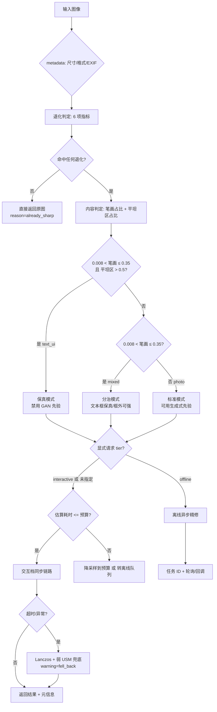

# 01 · 目标场景与模糊类型判定

> 本文定义"把模糊图片变清晰"这一能力的问题边界、退化类型判据与路由决策树。
> 后续两套方案（[03](03-plan-a-cpu-lightweight.md) / [04](04-plan-b-offline-heavy.md)）都复用本文的判定结果，不各自造轮子。

---

## 1. 能力定义

智能体接收到一张（或多张）图像，判定其**退化类型**与**内容类型**，选择处理档位，输出清晰化后的图像，并回填可解释的处理元信息。

| 项 | 定义 |
|---|---|
| 输入 | 单张图像（本地路径 / bytes / data URI），可选显式指定档位与放大倍数 |
| 输出 | 清晰化图像 + 元信息（退化类型、内容类型、模型链路、耗时、告警） |
| 不负责 | 去划痕、上色、去水印、换背景、人脸重绘（这些属于生成式编辑，风险等级完全不同） |
| 成功标准 | 文字笔画可辨认、无"虫状/水彩"伪影、色彩与原图一致、无过锐白边、无分块接缝 |

**核心立场：本能力的最大风险不是"不够清晰"，而是"清晰错了"。** 一张略微模糊但内容准确的截图，价值远高于一张"看起来很锐但把 `rn` 重绘成 `m`"的截图。因此所有链路以**保真优先**为默认，生成式先验必须显式开启。

---

## 2. 五类退化及其判别要点

| 退化类型 | 英文标识 | 物理成因 | 视觉特征 | 主要解法 |
|---|---|---|---|---|
| 低分辨率 | `lowres` | 截图后缩放、图标/缩略图拉伸、视频抽帧、远距裁切 | 边缘阶梯状锯齿、细节整体缺失、无方向性 | 超分辨率（SR） |
| 压缩伪影 | `jpeg` | 有损压缩（低码率 JPEG/WebP）、多次转发 | 8×8 块状边界、文字周围振铃、色度偏移 | 去压缩伪影 + 轻度 SR |
| 运动模糊 | `motion` | 相机/主体在曝光期间位移、屏幕翻拍抖动 | 单一方向的拖影、频谱出现方向性条纹 | 盲去模糊（deblur） |
| 失焦模糊 | `defocus` | 焦距未对准、镜头污渍、景深外 | 各向同性扩散、强边缘两侧出现对称暗边 | 盲去模糊（defocus deblur） |
| 混合退化 | `mixed` | 上述组合，**截图/文档场景最常见** | 缩放锯齿 + 块效应 + 轻微扩散叠加 | SR 为主 + 弱去模糊 |

### 2.1 各类型在截图/文档场景下的典型来源

| 场景 | 常见退化组合 |
|---|---|
| 网页/PPT 截图被微信、钉钉二次转发 | `jpeg + lowres`（强压缩 + 平台缩放） |
| 手机翻拍显示器、纸质文档 | `motion + defocus + jpeg` |
| 视频会议共享屏幕截帧 | `lowres + motion` |
| PDF 低 DPI 渲染后放大 | `lowres`（纯插值模糊，无压缩） |
| 老版软件/游戏 UI 截图 | `lowres`（像素级缩放，需最近邻或专用像素模型） |
| 高 DPI 截图缩小后展示 | `lowres`（下采样抗锯齿，细节量不足以恢复，**只能"重构合理边缘"**） |

> **重要边界**：如果原始细节信息已在下采样中被彻底丢弃（例如 4K 截图缩成 400px 再放大），任何模型都只能"猜测"。此时必须向用户明确：输出的是**合理重构**而非**真实还原**，且文字内容存在被重绘的风险。

---

## 3. 可执行的退化判定指标

以下均为**初始阈值**，必须在真实样本上标定（`poc/` 脚本可导出各指标值用于标定）。全部为纯 CPU 可承受的轻量计算（OpenCV + NumPy，单图 < 20ms）。

| 指标 | 计算方式 | 初始阈值 | 判定指向 |
|---|---|---|---|
| 全局模糊度 `blur_score` | 灰度图拉普拉斯方差（**ksize=1**） | `≥ 500` 足够清晰；`< 100` 模糊；`< 30` 严重模糊 | 是否需要处理 |
| 各向异性 `anisotropy` | 结构张量主方向能量集中度 `(λ1-λ2)/(λ1+λ2)` | `> 0.55` 且 `30 ≤ blur_score < 200` | 运动模糊 |
| 频谱高频占比 `hf_ratio` | FFT 幅值谱中半径 > 0.5·Nyquist 的能量占比 | `< 0.05` | 低分辨率 / 强失焦 |
| 块效应强度 `blockiness` | 8 像素网格边界梯度均值 / 非边界梯度均值 | `> 1.25` | JPEG 压缩伪影 |
| 边缘扩散指数 `edge_spread` | 强边缘（top 1%）的梯度中位数 / 拉普拉斯中位数（归一化，非像素） | `> 4.0` | 低分辨率 / 失焦 |
| 细节能量 `detail_energy` | 强边缘带上 `|detail| > 32` 的像素占比 | `> 0.30` 佐证"已足够锐" | 快速判退 |

> **实测校准值**（合成 800×600 文字图，OpenCV 5.1）：清晰图 `blur_score=844 / edge_spread=2.73 / detail_energy=0.56`；轻度模糊图 `83 / 6.69 / 0.10`；重模糊图 `1.3 / 27.3 / 0.0`。
> 因此阈值取 `blur_score` 500/100/30、`edge_spread` 4.0、`detail_energy` 0.30。**换机器或换内容类型必须重新标定。**

判据组合逻辑（避免单一指标误判）：

```
if blockiness > 1.25                                  → 追加 jpeg
if anisotropy > 0.55 and 30 <= blur_score < 200        → 追加 motion   # 严重模糊时各向异性会虚高，必须夹住下界
if edge_spread > 4.0 and anisotropy < 0.35             → 追加 defocus  # 用"各向同性"排除运动模糊
if hf_ratio < 0.05 or edge_spread > 4.0                → 追加 lowres
无任何命中 且 blur_score >= 500 且 detail_energy > 0.30 → 判定 none，直接返回原图
无任何命中 但 blur_score < 100                          → 判定 lowres
命中 ≥ 2 类                                            → 标记 mixed
```

**两个已踩过的坑**（POC 实测）：

1. `blur_score` 若用 `ksize=3`，数值会被放大一个数量级（实测 844 → 9845），所有阈值全部失效。
2. 早期用"边缘两侧出现对称极值"判定 `ringing`，在文字图上恒为高值（笔画本身就是对称极值），**不能用于失焦判定**。改用"各向异性 + 边缘扩散"组合，`detail_energy` 仅作"已足够锐"的佐证。

---

## 4. 内容类型判定（决定"能否使用生成式先验"）

| 内容类型 | 标识 | 判据 | 允许的处理强度 |
|---|---|---|---|
| 纯文字 / UI 截图 | `text_ui` | 笔画占比 ∈ (0.008, 0.35] **且** 平坦区占比 > 0.50；或笔画占比 > 0.15；或无笔画但平坦区 > 0.85 | **仅保真链路**：禁用 GAN 生成式先验，锐化增益上限收紧 |
| 图文混排 | `mixed` | 笔画占比 ∈ (0.008, 0.35] 但平坦区占比 ≤ 0.50 | **分治**：文本框内保真、框外可强 |
| 纯图像 | `photo` | 笔画占比为 0（无笔画，或全图皆高频纹理） | 可开启生成式先验（仍受档位限制） |

### 4.1 无 OCR 依赖的文本占比代理指标

生产环境建议用轻量 OCR（如 PaddleOCR 的检测分支，Apache-2.0）直接给出文本框面积占比；在不引入额外大依赖的前提下，POC 采用形态学代理法：

1. 灰度 → 黑帽变换（亮底暗笔画）与顶帽变换（暗底亮笔画），核 11×11；
2. 取两者最大值作为"细笔画响应"，阈值 = `max(18, P99 × 0.35)`；
3. 响应超阈值像素的占比即 `text_like_ratio`；
4. 该占比 > 0.35 时返回 0（全图皆高频 → 噪声/强纹理，不是文字）。

**实测值**（关键）：清晰文字截图 4.4%、轻度模糊 5.3%、重模糊 4.1%、纯噪声 100%（被截断为 0）、纯色渐变 0%。
因此"有无笔画"的判据是 `0.008 < r ≤ 0.35`，而非绝对值越大越像文字。

**已废弃的初版实现**：Canny → 闭运算 → 连通域按"面积 8~400 / 长宽比 0.15~6"过滤。
实测该法在真实文字图上只得到 0.07%~0.5%，原因是被闭运算连成整行的大块（面积 1600~6000）全被面积过滤丢弃，**几乎必然失效**。记录于此，避免重复踩坑。

代理法的残余误判点：细碎自然纹理（树叶、织物）会被判为 `mixed`。缓解办法是叠加"平坦区占比"——UI 截图有大量纯色区（实测 0.85+），照片几乎没有（实测 0.0015）。

---

## 5. 档位路由决策树



### 5.1 路由优先级规则

1. **显式请求优先**：调用方指定 `tier=offline` 则直接进离线队列，不再做耗时估算。
2. **安全优先于档位**：即使请求 `interactive`，若 `content_type=text_ui`，也必须走保真链路（不允许 GAN 先验）。
3. **预算优先于质量**：交互档估算耗时超预算时，先尝试降采样（`scale` 降级），仍超则转离线并返回任务 ID。
4. **永不失败**：任何模型加载失败、权重缺失、推理异常，都必须回落到插值兜底，返回可用图像 + `warnings`。

---

## 6. 低置信度降级规则

| 情形 | 处置 | 返回的 `warnings` |
|---|---|---|
| 退化指标处于阈值边界（±10%） | 保守处理：只放大不锐化 | `low_confidence_degradation` |
| 内容类型无法判定 | 按 `text_ui` 处理（最保守） | `content_type_uncertain` |
| 输入尺寸 > 4000px 边长 | 分块，且禁止全局锐化 | `large_image_tiled` |
| 输入已是高质量（`blur_score` > 500 且 `hf_ratio` > 0.15） | 直接返回原图 | `already_sharp` |
| 检测到大幅旋转/透视畸变 | 不处理几何形变，仅做清晰化 | `geometry_not_corrected` |

---

## 7. 与后续方案的接口

本文输出三个字段，作为 [03](03-plan-a-cpu-lightweight.md) 与 [04](04-plan-b-offline-heavy.md) 的唯一输入：

```python
degradation_type: str   # motion | defocus | lowres | jpeg | mixed | none
content_type: str       # text_ui | mixed | photo | unknown
confidence: float       # 0~1，取各指标命中强度的加权
```

两套方案不得自行重新判定，保证同一张图在两个档位下的判定结果一致——这是后续做 A/B 对比与问题回溯的前提。
