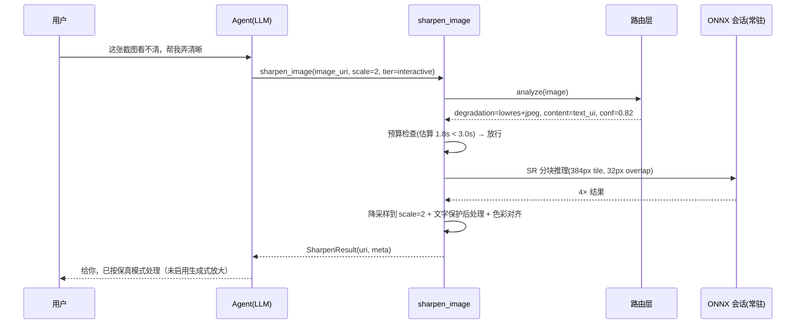

# 03 · 方案一：纯 CPU 轻量判别式级联（交互档）

> **一句话**：用 1.2M 参数的 `realesr-general-x4v3` 做主力超分，按退化判定可选叠加 NAFNet-width32 去模糊，全部跑在 ONNX Runtime CPU 上，进程内同步调用，单图秒级返回，任何异常都回落到插值兜底。

---

## 1. 方案思路

**"小模型 + 强编排"**。不在模型侧追求 SOTA，而是把工程约束（CPU、秒级、不能出错、文字不能糊）转化为一条确定性的流水线：

```
质量分析 → 生成式先验开关 → 轻量 SR → (可选) 轻量去模糊 → 文字保护后处理 → 兜底判定
```

三条设计原则：

1. **能不做就不做**：图像已经足够清晰（`blur_score` 高于阈值且高频充足）时直接返回原图，节省 100% 算力。
2. **能小不大**：所有决策优先选最轻的可用模型，只有判定为 `motion`/`defocus` 时才引入去模糊网络。
3. **能退不崩**：模型缺失、算子不支持、超时——一律降级，永不抛异常（Agent 会话不能因为一张图挂掉）。

---

## 2. 选用的开源项目

| 环节 | 选用 | 许可证 | 规模 | 选择理由 |
|---|---|---|---|---|
| 主力超分 | Real-ESRGAN `realesr-general-x4v3`（ONNX） | BSD-3-Clause | 1.2M / 4.6MB | 真实退化训练、体积小、有现成 ONNX 导出（fp32, opset 17, 动态 H/W） |
| 极速兜底超分 | OpenCV `dnn_superres` — FSRCNN / ESPCN | Apache-2.0 | 0.01~0.04M | 10~13ms 级（768×512×4，i7-9700K），零模型管理负担 |
| 质量兜底超分 | OpenCV `dnn_superres` — EDSR | Apache-2.0 | ~43M / 60MB | 单图 3.27s，PSNR 明显高于 FSRCNN；仅在 FSRCNN 不满足时用 |
| 去模糊 | NAFNet-width32（按退化类型选 GoPro/DPDD 权重） | MIT | ~17.1M | CPU 侧唯一有实用可能的去模糊网络；有官方 `predict.py` 可参考 |
| 最终兜底 | Lanczos 重采样 + 弱 USM | 无（OpenCV/numpy） | — | 零依赖、零风险、永远可用 |
| 推理运行时 | onnxruntime（CPU EP） | MIT | — | 图优化 + INT8 动态量化 + 线程可控 |

**明确不用**：RealESRGAN_x4plus（16.7M，CPU 太慢，留给离线档）、所有 Transformer 类（SwinIR/HAT/Restormer）、所有扩散模型、GFPGAN（许可风险 + 无人脸需求）。

---

## 3. 在智能体中的集成方式

### 3.1 形态：进程内直接调用（推荐），HTTP 为可选降级

Python Agent 直接 `import` 工具模块，模型会话进程级单例常驻，**零网络开销、零序列化开销**。

```
agent/
└── tools/
    └── sharpen_image.py   ← 本方案实现（POC 见 poc/deblur_tool.py）
```

- 首次调用时懒加载模型（约 0.3~1s），后续调用复用会话。
- 若 Agent 为多进程/多租户部署，改为 FastAPI 单 worker 服务 + HTTP 调用，**接口契约不变**（见第 5 节）。

### 3.2 暴露给 LLM 的工具定义

```python
SHARPEN_TOOL_SCHEMA = {
    "name": "sharpen_image",
    "description": (
        "把模糊的图片（低分辨率、压缩、轻微运动/失焦模糊）变清晰。"
        "当用户提供模糊截图、看不清文字的图片，或要求'放大/修复/变清晰'时调用。"
        "不会修改图片内容的语义，只做清晰化；不适用于去水印、去划痕、换背景。"
    ),
    "parameters": {
        "type": "object",
        "properties": {
            "image_uri": {"type": "string", "description": "图片路径或 data URI"},
            "scale": {"type": "integer", "enum": [1, 2, 4], "default": 2},
            "tier": {"type": "string", "enum": ["interactive", "offline"],
                     "default": "interactive"},
            "allow_generative_prior": {"type": "boolean", "default": False,
                     "description": "仅纯照片场景可置 true；文字/UI 截图必须为 false"},
        },
        "required": ["image_uri"],
    },
}
```

> 工具描述里写清"不适用场景"很关键：模型倾向于对"去水印"这类请求也调用它，需在描述层阻断。

### 3.3 一次调用的完整时序



---

## 4. 处理链路细节

### 4.1 Step 0 — 快速判退

| 检查 | 动作 |
|---|---|
| `blur_score > 500` 且 `hf_ratio > 0.15` | 判定已足够清晰，原图返回，`tier_used=none`，耗时 < 30ms |
| 边长 > 4000px | 标记 `large_image_tiled`，强制分块，禁用全局锐化 |
| 图像 < 32×32 | 直接 Lanczos 兜底（模型无意义） |

### 4.2 Step 1 — 模型选择

```python
if degradation == "none":               return original
if degradation in ("lowres","jpeg"):    chain = [sr_light]
if degradation in ("motion","defocus"): chain = [deblur_w32, sr_light]
if degradation == "mixed":              chain = [sr_light, deblur_w32_weak]  # 去模糊用低强度
if content_type == "text_ui":           allow_generative_prior = False       # 硬约束
```

**保真模式的后端排序**（`text_ui` 且未开启生成式先验时）：

```
非 GAN 模型（EDSR / FSRCNN） → GAN 轻量模型（x4v3，锐化减半） → Lanczos
```

即 `x4v3` 虽是全局主力，但在纯文字/UI 场景中**排在非 GAN 模型之后**。理由：x4v3 虽温和，仍是 GAN 训练目标，会轻微强化笔画边缘，在密集小字上叠加后产生粘连。EDSR 质量更高但慢（约 3s/图），FSRCNN 极快但质量一般——两者按实际耗时预算取舍。若两者都未部署，才回落到 x4v3 + 零额外锐化。

### 4.3 Step 2 — 分块推理 + 接缝融合

对超大图直接整图推理会 OOM（RRDBNet 4× 放大的中间特征约为 `16 × 4 × H × W × 4B`）。分块策略：

| 参数 | 取值 | 说明 |
|---|---|---|
| `tile` | 384（x4v3）/ 256（NAFNet） | 兼顾吞吐与显存/内存峰值 |
| `overlap` | 32（约 8%） | 覆盖感受野，避免接缝 |
| 融合 | 余弦/线性羽化权重叠加 | 重叠区按到边界距离加权，避免硬拼缝 |
| 峰值内存 | O(tile²·C) 而非 O(W·H) | 与图像总尺寸无关 |

关键点：**输出拼接必须在 4× 分辨率空间做**（即每块推理后立刻放大，再在放大空间融合），否则重叠区错位会产生网格状伪影。

### 4.4 Step 3 — 文字保护后处理

针对 `text_ui` / `mixed`：

1. **锐度抑制**：USM 增益 `amount = 0.35 × (1 - text_like_ratio)`，半径固定 1.0；`text_like_ratio > 0.15` 时 `amount = 0`。
2. **过冲钳位（anti-halo）**：`out = clip(out, src_dilated - δ, src_dilated + δ)`，δ 取 12/255，防止白边。
3. **色彩对齐**：对每通道做均值/方差匹配到原图（Reinhard 统计迁移），消除 GAN 带来的色偏。
4. **振铃核查**：若处理后在平坦区检测到新增高频能量，则对该区域做一次轻微高斯（σ=0.6）回退。

### 4.5 Step 4 — 兜底链

```
ONNX x4v3 → dnn_superres(FSRCNN) → dnn_superres(EDSR) → Lanczos+USM
```

任一层成功即返回，`model_chain` 字段记录实际使用的链路；全部失败时返回原图的 Lanczos 放大版，`warnings` 追加 `fell_back_to_lanczos`。**函数永远返回 `SharpenResult`，不抛异常。**

---

## 5. 输入输出契约

```python
from dataclasses import dataclass, field
from typing import Literal, Optional

Tier = Literal["interactive", "offline", "fallback", "none"]

@dataclass
class SharpenRequest:
    image_uri: str                        # 本地路径或 data URI
    tier: Tier = "interactive"
    scale: Literal[1, 2, 4] = 2
    allow_generative_prior: bool = False  # 文本场景默认关闭
    max_latency_ms: int = 3000

@dataclass
class SharpenResult:
    output_uri: Optional[str]             # 失败时为 None
    tier_used: Tier = "fallback"
    degradation_type: str = "unknown"     # motion/defocus/lowres/jpeg/mixed/none
    content_type: str = "unknown"         # text_ui/mixed/photo/unknown
    model_chain: list[str] = field(default_factory=list)
    elapsed_ms: int = 0
    warnings: list[str] = field(default_factory=list)
```

该契约是**两套方案共用的边界**：方案一只实现 `interactive` 分支；方案二在其上增加 `offline` 异步实现，返回结构保持一致，Agent 侧无需区分。

### 5.1 HTTP 形态（多进程部署时）

```
POST /v1/sharpen
  multipart: file=<image>, params={"scale":2,"tier":"interactive"}
  → 200 {"output_url":"...","meta":{...SharpenResult...}}

错误约定：不返回 5xx。兜底成功即 200 + warnings；真正无法读取图像才返回 400。
```

---

## 6. 部署与性能

### 6.1 依赖

```text
onnxruntime>=1.17      # CPU EP
opencv-contrib-python>=4.8   # dnn_superres 在 contrib 中
numpy>=1.24
Pillow>=10.0
```

不依赖 `torch` / `basicsr`（这是选 ONNX 的核心收益：镜像体积从 ~2GB 降到 ~200MB）。

### 6.2 运行时配置

| 配置项 | 建议值 | 理由 |
|---|---|---|
| `intra_op_num_threads` | 物理核数 - 1 | 留一核给 Agent 主循环，避免争用 |
| `inter_op_num_threads` | 1 | 单请求串行，多线程无收益 |
| `graph_optimization_level` | `ORT_ENABLE_ALL` | 卷积融合收益明显 |
| 量化 | INT8 动态量化（`quantize_dynamic`） | 体积 ↓4×、速度 ↑1.3~2×，文字场景精度损失可接受（需实测确认） |
| 会话生命周期 | 进程级单例 | 加载耗时 0.3~1s，不可每次重建 |
| 并发策略 | 每进程 1 个推理锁 | 小模型多线程并行会互相拖慢 |

### 6.3 耗时预算（估算，非实测）

> 以下为**结构推算 + 外部参考值**，必须在目标机器上用 `poc/` 实测替换。假设：8 核 CPU，1080p 输入（1920×1080），`scale=2`。

| 环节 | 估算耗时 | 依据 |
|---|---|---|
| 质量分析（6 项指标） | 15~30ms | OpenCV 全图统计，O(N) |
| dnn_superres FSRCNN ×2 | 60~150ms | 官方基准 0.013s @768×512 → 线性外推 |
| ONNX x4v3 分块（分块推理） | **≈ 16 ms / 千像素** | 实测拟合，见下表 |
| NAFNet-width32（仅模糊时，256 tile） | 待实测 | ~17M 参数、无激活函数设计 |
| 文字保护后处理 | 30~80ms | 全图 USM + 统计匹配 |
| 兜底 Lanczos | 20~50ms | 重采样 |

### 实测结果（2026-11-18，12 核 CPU / ONNX Runtime 1.32 / `realesr-general-x4v3.onnx`）

| 输入尺寸 | 像素量 | 链路 | 实测耗时 | 备注 |
|---|---|---|---|---|
| 400×300 | 0.12 MP | `realesr-general-x4v3` | **1.69 ~ 2.08 s** | 2× 输出 |
| 1280×720 | 0.92 MP | `lanczos`（预算裁决跳过重模型） | 1.55 s | est=15.0s > 预算 3s×2 |
| 1280×720 | 0.92 MP | `realesr-general-x4v3`（不设预算） | **14.5 s** | 原表估算 1.5s，**低估约 10 倍** |
| 800×600（清晰） | 0.48 MP | `passthrough` | 83 ms | 判退生效 |

**结论修正**：

- 原表"1080p 仅 SR ≈ 1.5~3.5s"是**错的**。按 16 ms/千像素外推，1080p（2.07 MP）约 **33 s**，属离线档而非交互档。
- **交互档的真实容量上限约为 0.12~0.15 MP（≈ 400×300 ~ 450×330）**。超过此尺寸必须二选一：
  1. 部署非 GAN 快模型（FSRCNN/ESPCN，实测十余毫秒级）走保真链路；
  2. 转离线档异步处理。
- 因此 `resolve_backends()` 增加预算裁决：预估耗时 > `2 × max_latency_ms` 时**剔除 GAN 重模型**，直接走快链路，并返回 `heavy_model_skipped_over_budget(est=...)` 告警。
- **不做"降采样到预算再放大"**：输出分辨率会形同虚设（480p 处理 → 4K 输出），观感比"用快模型放大"更差。
- 预算估算系数从 1300 ms/MP 修正为 16000 ms/MP（约 12 倍误差），否则 3 秒预算下会放过一个要跑 15 秒的模型。

> 兜底链路实测：400×300 → 2× 耗时 189 ms；清晰图判退 < 30 ms。

### 6.4 超时与降级策略

```python
预算裁决在进入链路前完成（进入后无法"半途反悔"，只会更糟）：
  est = 16 ms/千像素 × 像素量
  est > 2 × max_latency_ms → 剔除 GAN 重模型，直接走快链路（FSRCNN/Lanczos）
                             并返回 heavy_model_skipped_over_budget(est=...)
否则 → 正常执行；执行完若仍超预算，附 exceeded_budget 告警（但不丢结果）
```

**为什么不在链路中途降级**：已完成的块与未跑的块用不同模型，会在同一张图上出现两种质感，接缝比模糊更刺眼。**也不做"降采样到预算"**——480p 处理再放大，输出分辨率形同虚设。

不允许"部分区域清晰、部分区域原样"的情况出现在同一块内——接缝比模糊更刺眼。

---

## 7. 优缺点

### 优点

1. **可商用无争议**：BSD-3 + Apache-2.0 + MIT，无 AGPL/NC 风险。
2. **部署极轻**：无 torch，镜像 < 300MB，冷启动 < 1s，适合容器化与边缘部署。
3. **结果确定性强**：同一输入同一参数结果稳定，便于回归测试与用户预期管理。
4. **不会幻觉内容**：判别式模型只重构边缘，不会凭空造出文字——这对文档场景是决定性的。
5. **失败可控**：四级兜底，永不抛异常。
6. **成本可预测**：纯 CPU，无 GPU 排队与冷启动问题，单机可估算吞吐。

### 缺点

1. **质量上限低**：重度模糊（`blur_score < 30`）时只能做到"边缘更利"，无法真正还原细节。
2. **文字场景收益有限**：`text_ui` 禁用生成式先验后，多数情况收益接近"高质量 Lanczos + 轻度锐化"，用户可能感知不到"AI 感"。
3. **x4v3 在 CPU 上远非实时**：实测 16 ms/千像素，400×300 约 1.7~2.1s、720p 约 14.5s、1080p 约 33s。交互档实际只装得下 **≤ 0.12~0.15 MP** 的图片，大图必须靠预算裁决跳过重模型。
4. **需要一次 ONNX 化工作**：NAFNet 需自行导出并验证动态 shape（Real-ESRGAN 有现成导出）。
5. **去模糊能力弱**：NAFNet-width32 仅为质量下限，对真实运动模糊改善有限。

### 适用边界

- ✅ 截图/文档/UI 的低分辨率、压缩伪影
- ✅ 轻中度模糊，要求"立刻返回、结果稳定"
- ✅ 无 GPU 的私有化/边缘部署
- ❌ 重度模糊、需要"无中生有"补细节
- ❌ 需要 4K 级输出的高质量放印

---

## 8. 具体落地清单

| 步骤 | 产物 | 验收标准 |
|---|---|---|
| 1 | 下载 `realesr-general-x4v3.onnx`（4.6MB，BSD-3） | 文件 SHA256 校验通过，licenses 归档 |
| 2 | 实现 `sharpen_image` 工具（POC 已有骨架） | 30 张真实截图跑通，无异常 |
| 3 | 标定 6 项判定阈值 | 人工标注 50 张 → 判定准确率 > 80% |
| 4 | 实测耗时并替换本文估算表 | 目标机器出 p50/p95 数据 |
| 5 | 接入 Agent 工具注册表 | LLM 能在正确时机调用、不误触发 |

> 第 2~4 步的实测数据应回写到本文 6.3 节，覆盖"估算"标注。
