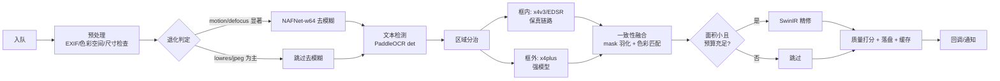
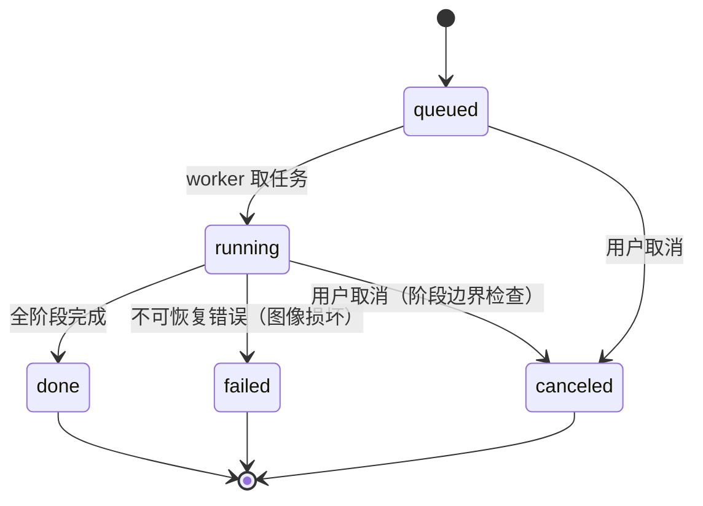

# 04 · 方案二：离线重型精修流水线（异步档）

> **一句话**：把"质量上限"交给重型判别式模型（`RealESRGAN_x4plus` + NAFNet-width64 + 可选 SwinIR），用**文本区域分治**解决"框内必须保真、框外可以更锐"的矛盾，通过异步任务队列在夜间/低峰期消耗 CPU，单图数十秒到分钟级。

---

## 1. 方案思路

交互档解决"快"，本方案解决"好"。两者共用同一套判定结果（见 [01](01-scenarios.md)），差异在于**允许的算力预算**与**允许的模型规模**。

三条核心机制：

1. **多模型顺序精修**：单模型无法同时解决"放大 + 去模糊 + 去压缩"，按"先修显著退化、再放大、最后精修"的顺序串联，每步只做一件事。
2. **文本区域分治**：这是本方案与"直接换个大模型"的本质区别。文字框内用保真链路（禁用 GAN、限制锐化），框外用强模型，最后按 mask 羽化融合。**同图不同策略**，才能既清晰又不糊字。
3. **异步 + 可中断**：任务入队、进度可查、结果落盘、按哈希复用。CPU 上单 worker 串行，避免上下文切换抖动。

---

## 2. 选用的开源项目

| 环节 | 选用 | 许可证 | 规模 | 定位 |
|---|---|---|---|---|
| 重型超分 | Real-ESRGAN `RealESRGAN_x4plus` | BSD-3-Clause | RRDBNet 16.7M / ONNX 64MB | 主放大引擎；**文字框内禁用** |
| 保真超分（框内） | Real-ESRGAN `realesr-general-x4v3` 或 dnn_superres EDSR | BSD-3 / Apache-2.0 | 1.2M / 43M | 框内保守放大 |
| 去模糊 | NAFNet-width64（GoPro / DPDD 权重按判定选） | MIT | ≈67.9M | 显著退化时的主修复 |
| 精修（可选） | SwinIR real-SR | Apache-2.0 | ~11.8M | 小面积图像的质量天花板；面积大则跳过 |
| 文本检测 | PaddleOCR（仅检测分支） | Apache-2.0 | 轻量 | 给出文本框，驱动分治 |
| 任务编排 | 自建（标准库 `queue` / 或 Redis + RQ） | — | — | 单机单 worker 起步 |

**明确不用**：DiffBIR / SUPIR / StableSR（许可与文字幻觉双重问题，见第 7 节）。

---

## 3. 流水线设计

### 3.1 阶段编排



**顺序依据**：先修模糊再放大（模糊会被放大放大）；先去压缩再锐化（块效应会被锐化强化）；最后精修（避免精修模型放大已有伪影）。

### 3.2 文本区域分治

```python
boxes = paddle_det(image)                 # 文本框列表
text_mask = dilate(rasterize(boxes), 3)   # 膨胀 3px 覆盖笔画外沿

inside  = run_chain(image, mode="fidelity")    # x4v3 + 无锐化 + 无反锐化
outside = run_chain(image, mode="aggressive")  # x4plus + 轻度 USM

result = feather_blend(outside, inside, text_mask, radius=6)
result = match_color_stats(result, image)      # 整体色彩对齐原图
```

关键细节：

| 细节 | 处理方式 | 原因 |
|---|---|---|
| mask 膨胀 | 3~6px | 文字边缘的抗锯齿像素若走强模型，会立刻出现毛刺 |
| 融合半径 | 6~8px | 硬边融合会在文字周围形成"描边" |
| 色彩对齐 | 全图统计匹配（分通道均值/方差） | 两条链路色彩倾向不同，不匹配会出现可见色块 |
| 框内放大倍数 | 与框外一致 | 倍数不同会导致融合区错位 |

### 3.3 一致性校验（必须做）

分治最容易翻车的不是单区域质量，而是**接缝与色差**。落盘前自动检查：

| 检查 | 阈值 | 不通过时 |
|---|---|---|
| 融合区梯度突变 | 与周边方差比 > 1.5 | 扩大融合半径重跑一次 |
| 文字框内对比度变化 | 与原图偏差 > 25% | 该框回退为原图区域 + Lanczos |
| 全图色差 ΔE | > 5 | 强制色彩匹配 |

---

## 4. 输入输出与异步接口

### 4.1 与 Agent 的交互契约

请求体复用方案一的 `SharpenRequest`，`tier="offline"`。返回值改为任务句柄：

```python
@dataclass
class SharpenTask:
    task_id: str
    status: Literal["queued", "running", "done", "failed", "canceled"]
    progress: float               # 0~1，按阶段加权
    stage: str                    # preprocess/deblur/detect/sr/refine/validate
    created_at: str
    eta_seconds: int              # 基于历史同尺寸任务的中位数
    result: Optional["SharpenResult"] = None   # done 时填充
```

### 4.2 调用流程（Agent 视角）

```
1. Agent 调 sharpen_image(tier="offline")
   → 立即返回 {task_id, eta_seconds}，不阻塞会话

2. Agent 回复用户："已提交精修任务，预计 2 分钟，完成后通知你"

3a. 回调模式：Agent 注册 webhook / 会话事件，任务完成时主动推送
3b. 轮询模式：get_sharpen_task(task_id)
```

工具层需同时暴露三个函数，LLM 才能自主完成"提交 → 等待 → 取回"：

| 工具 | 作用 |
|---|---|
| `sharpen_image(tier="offline")` | 提交任务，返回 `task_id` |
| `get_sharpen_task(task_id)` | 查询状态与结果 |
| `cancel_sharpen_task(task_id)` | 取消（用户在队列中反悔） |

### 4.3 状态机



**可恢复错误**（模型缺失、单阶段异常）不进入 `failed`，而是降级到次优链路并记 `warnings` ——只有"图像本身无法解码"才算 `failed`。

### 4.4 存储与缓存

| 项 | 设计 |
|---|---|
| 存储 | 本地目录 `/var/lib/sharpen/{task_id}/{input,output}.png`；多机时换对象存储 |
| 缓存键 | `sha256(原图字节) + model_chain + 参数串` |
| 命中策略 | 命中直接返回，`elapsed_ms` 记 0，`warnings += ["cache_hit"]` |
| 保留期 | 默认 7 天，原图与结果同生命周期 |
| 幂等 | 同一 `input_hash + params` 重复提交返回已有 `task_id`（`queued/running` 时） |

---

## 5. 部署与吞吐

### 5.1 部署形态

| 形态 | 适用 | 说明 |
|---|---|---|
| 单机单 worker | 私有化、日处理量 < 2000 张 | 最简单，CPU 利用率最高 |
| Redis + RQ/Celery 多 worker | 需水平扩展 | **每 worker 需 2~4 物理核**，超配会互相拖慢 |
| 独立服务 + 共享存储 | 与 Agent 分离部署 | Agent 侧只持有轻量客户端 |

并发建议：**CPU 上 1 任务 1 核组**，不要把多个任务塞进同一组核，切换开销会让总吞吐下降 20~30%。

### 5.2 吞吐估算（估算，非实测）

假设 8 核 CPU、1920×1080 输入、`scale=2`：

| 阶段 | 单图耗时估算 | 说明 |
|---|---|---|
| 预处理 + 判定 | 0.05s | 与方案一共用 |
| NAFNet-w64 去模糊（若需要） | 8~25s | 67.9M 参数，1080p 需分块 |
| 文本检测 | 0.3~1.0s | PaddleOCR det，CPU |
| x4plus 超分（框外，分块） | 15~45s | 16.7M RRDBNet，CPU 上为主导成本 |
| x4v3 超分（框内） | 3~8s | 仅文本框区域 |
| 融合 + 校验 | 0.2~0.5s | O(N) |
| SwinIR 精修（可选） | 30~120s | 面积大时禁用 |
| **合计** | **25~80s**（不含 SwinIR） | ≈ **1~2.5 张/分钟/8 核** |

**量级判断**：日均 500 张需约 4~8 小时 CPU 时间，单 worker + 夜间批处理是合理配置。若日需求 > 2000 张，纯 CPU 不经济，应上 GPU 或改走交互档。

> 所有数字为结构推算，**必须用 `poc/` 在目标机器实测替换**；实测时建议记录 p50/p95 而非均值。

### 5.3 资源控制

- 单任务峰值内存由分块控制（tile 256~512），上限约 `1.5GB`（含 x4plus 中间特征）。
- 任务级超时（默认 300s），超时后保存已完成阶段结果并降级收尾，不整体丢弃。
- 低峰调度：支持 `window: "02:00-06:00"` 参数，队列在窗口外暂停消费。

---

## 6. 与方案一的关系

| 维度 | 方案一 | 方案二 |
|---|---|---|
| 触发方式 | 同步返回 | 异步任务 + 轮询/回调 |
| 共用部分 | 判定层、IO 契约、兜底策略、后处理工具函数 | 同左 |
| 差异部分 | 轻量模型、单遍处理 | 重型模型、多遍 + 文本分治 |
| 代码组织 | `tools/sharpen_image.py` | 在其上增加 `workers/pipeline.py`，复用 `Enhancer` 协议 |

建议的抽象：把模型封装为统一的 `Enhancer` 协议，方案一只注册 2 个实现，方案二注册 4 个实现并加入编排器。**新增模型不改编排代码**。

```python
class Enhancer(Protocol):
    name: str
    cost_level: int          # 1=轻 2=中 3=重
    def applicable(self, deg: str, content: str) -> bool: ...
    def enhance(self, img: np.ndarray, mode: str) -> np.ndarray: ...
```

---

## 7. 为什么不选扩散模型（取舍论证）

这是本方案最重要的决策，需明确记录理由：

| 维度 | 扩散（DiffBIR/SUPIR） | 本方案（重型判别式） |
|---|---|---|
| 许可证 | SUPIR/StableSR 非商用；DiffBIR 代码 Apache-2.0 但基座 OpenRAIL++-M 带使用限制 | 全部 MIT/Apache-2.0/BSD-3，无争议 |
| 文字正确性 | **会幻觉出不存在的笔画**，`rn`→`m`、`0`→`O` 类错误无法通过参数消除 | 只重构边缘，不生成新语义 |
| CPU 可行性 | 单图分钟级，且需要 12GB+ 显存级模型（CPU 上内存与时间双爆） | 可用，单图 25~80s |
| 可解释性 | 输出与输入的像素级对应关系弱，难做回归 | 输出与原图对齐，可逐区域校验 |
| 失败模式 | 幻觉（正确性错误，不可接受） | 只是不够清晰（可接受） |

**结论**：在"文档/截图 + 无 GPU + 必须商用"的三重约束下，扩散模型的三个致命点（许可、幻觉、成本）全部命中，不作为主链路。

### 7.1 GPU 演进路线（保留的口子）

若未来具备 GPU，按以下顺序升级：

1. **保留本方案**，把 x4plus 换成 TensorRT 加速（10~20× 提速），吞吐先提上来；
2. 新增 `DiffBIREnhancer` 实现，**仅对 `content_type=photo` 开放**，`text_ui`/`mixed` 仍走判别式；
3. 若必须处理重度老照片，评估 SUPIR **商业授权**（当前许可禁止商用，需与作者联系）。

架构上只需新增一个 `Enhancer` 实现 + 一条路由规则，不改编排代码——这是引入 `Enhancer` 协议的直接收益。

---

## 8. 优缺点

### 优点

1. **质量上限显著高于方案一**：x4plus + w64 去模糊 + 可选 SwinIR，对中等退化图像改善明显。
2. **文本分治解决核心矛盾**：既让框外更锐，又保住框内文字不被重绘。
3. **许可证全绿**：可放心用于商业化产品。
4. **可扩展性好**：`Enhancer` 协议 + 阶段编排，加模型/换模型成本低。
5. **成本可控**：无 GPU 依赖，夜间批处理，按任务超时与窗口调度控制峰值。
6. **结果可审计**：每阶段产物可落盘，问题可定位到具体环节。

### 缺点

1. **时延不可接受用于交互**：单图 25~80s，必须异步，用户体验依赖"通知-取回"闭环。
2. **CPU 吞吐低**：约 1~2.5 张/分钟/8 核，日处理量受限。
3. **工程复杂度高**：任务队列、状态机、分治、一致性校验、缓存，任一环节出问题都影响可用性。
4. **调参成本高**：融合半径、mask 膨胀、色彩匹配阈值都需按真实样本调，通用默认值不保证最优。
5. **PaddleOCR 引入额外依赖**：约 100MB 级模型，需单独管理。

### 适用边界

- ✅ 用户可接受"提交-等待-通知"的异步流程
- ✅ 中等退化、需要明显改善质量的截图/文档
- ✅ 批量整理历史截图、知识库图片清洗
- ✅ 私有化部署、无法上 GPU
- ❌ 对话中即时查看结果
- ❌ 重度模糊（细节已彻底丢失）——仍需向用户说明"重构≠还原"

---

## 9. 具体落地清单

| 步骤 | 产物 | 验收标准 |
|---|---|---|
| 1 | 下载 `RealESRGAN_x4plus.onnx`（64MB）+ 导出 NAFNet-w64 ONNX | 两次推理结果与 PyTorch 参考实现 PSNR > 40dB |
| 2 | 实现任务表 + 单 worker 消费 | 提交/查询/取消三接口跑通，重启不丢 queued 任务 |
| 3 | 接入 PaddleOCR det，实现 mask 生成与羽化融合 | 20 张图文混排样本无明显接缝 |
| 4 | 实现一致性校验三项检查 | 人为构造接缝/色差样本能被拦截 |
| 5 | 实测吞吐，替换 5.2 节估算 | 目标机器出"张/分钟"实测值 |
| 6 | 接入缓存与幂等 | 重复提交命中缓存，`warnings` 含 `cache_hit` |
