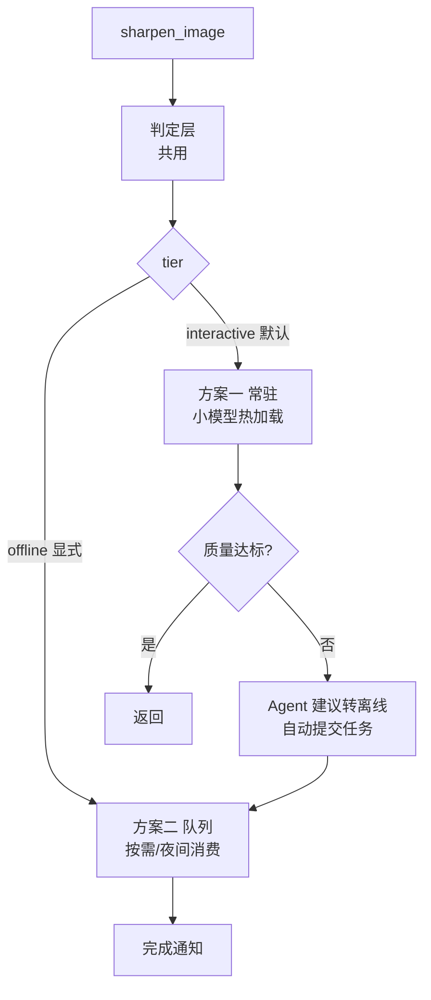

# 05 · 对比矩阵、选型建议与风险清单

## 1. 五维对比

评分口径：5 = 最优，1 = 最差。"成本"分数越高代表越省。

| 维度 | 权重 | 方案一（CPU 轻量级联） | 方案二（离线重型精修） | 说明 |
|---|---|---|---|---|
| 画质上限 | 25% | **2** | **4** | 方案二多模型串联 + 文本分治，中等退化改善明显；但两者都到不了扩散模型的重构能力 |
| 时延 / 体验 | 25% | **4**（实测 400×300 ≈ 2s；720p 需预算裁决降级） | **1**（25~80s 异步） | 方案二必须走"提交-等待-通知"；方案一在 >0.15MP 时也装不进 3s 预算 |
| CPU 成本 | 20% | **5**（1.2M 参数） | **2**（16.7M+67.9M） | 方案二单图算力约方案一的 15~30 倍 |
| 工程复杂度 | 15% | **5**（单文件即可） | **2**（队列/状态机/分治/校验/缓存） | 方案二任一环出问题都影响可用性 |
| 合规风险 | 15% | **5**（BSD-3/Apache/MIT） | **4**（同期可商用，但引入 PaddleOCR 等更多依赖需一并归档许可） | 两者均无 AGPL/NC 风险 |
| **加权总分** | — | **4.25** | **2.75** | — |

### 1.1 但总分不是决策依据

加权总分只说明"方案一更容易落地"。实际选择取决于**你的场景更需要哪一个维度**：

| 如果你的第一优先级是… | 选 |
|---|---|
| 对话体验、结果稳定、部署简单 | 方案一 |
| 画质、批量整理历史素材、可接受等待 | 方案二 |
| 两者都要 | **混合部署**（见第 3 节） |

---

## 2. 四类典型场景的选型结论

### 场景 A：对话中用户随手发一张模糊截图问"这写的什么"

- **选方案一**，`content_type=text_ui` → 保真模式。
- 理由：用户在等，3 秒内必须出结果；文字场景方案二的额外画质收益不足以抵消 30 秒等待。
- 附加动作：若结果仍不可读，Agent 应主动建议"可以试试离线精修"并提交方案二任务。

### 场景 B：知识库/文档批量清洗（几千张历史截图）

- **选方案二**，夜间窗口批处理。
- 理由：无时延压力，画质提升直接决定 OCR 召回率；缓存与幂等能显著减少重复计算。
- 附加动作：按 `content_type` 预分组，`text_ui` 组可跳过 SwinIR 精修以省算力。

### 场景 C：手机翻拍纸质文档的轻度运动/失焦模糊

- **方案一 + 强制去模糊分支**（NAFNet-width32 GoPro/DPDD 权重）先行；不满意再转方案二（width64）。
- 理由：这类退化靠去模糊网络本身改善最大，超分不是主要矛盾；先用小模型验证收益再决定是否上重型。
- 注意：翻拍常伴随透视畸变，**本能力不处理几何校正**，需在工具描述中明确。

### 场景 D：老照片/低质素材"修复"

- **两套方案都不是正确答案**。用户期望的是"生成式重构"，而这需要扩散模型——同时踩中许可（SUPIR/StableSR 非商用）与幻觉（人物五官被改写）两个坑。
- 建议：明确告知能力边界，输出"清晰化"而非"修复"；如确有必要，评估 SUPIR 商业授权 + GPU 后再立项。

---

## 3. 混合部署建议（推荐给大多数团队）

交互档常驻 + 离线档按需，共享同一套判定层与 IO 契约：



落地节奏建议：

| 阶段 | 内容 | 周期估计 |
|---|---|---|
| P0 | 方案一跑通（POC 骨架 + 阈值标定 + 实测耗时） | 3~5 人日 |
| P1 | 接入 Agent 工具注册，建立 30 张真实样本回归集 | 2~3 人日 |
| P2 | 方案二队列 + 文本分治（若场景 B 有需求） | 8~12 人日 |
| P3 | 一致性校验、缓存、监控告警 | 3~5 人日 |

> 不要同时开工 P0 与 P2。方案二的很多设计（分治参数、融合半径）依赖方案一在真实样本上暴露的问题。

---

## 4. 合规清单

### 4.1 可直接商用

| 项目 | 许可证 | 分发义务 |
|---|---|---|
| Real-ESRGAN（代码 + 全部官方权重） | BSD-3-Clause | 保留版权声明、许可文本、免责声明；不得暗示作者背书 |
| NAFNet | MIT | 保留版权声明与许可文本 |
| Restormer | MIT | 同上 |
| SwinIR / HAT / BSRGAN | Apache-2.0 | 保留 LICENSE 与 NOTICE，标注修改文件 |
| OpenCV（含 dnn_superres） | Apache-2.0（部分 3-clause BSD） | 保留 LICENSE |
| onnxruntime | MIT | 同上 |
| PaddleOCR | Apache-2.0 | 同上 |

### 4.2 禁止或需授权

| 项目 | 问题 | 处置 |
|---|---|---|
| SUPIR | 自定义许可，仅非商用 | 不得集成；如需商用联系作者授权 |
| StableSR | NTU S-Lab 1.0 非商用 | 不使用 |
| CodeFormer | NTU S-Lab 1.0 非商用 | 不使用 |
| GFPGAN | 代码 Apache-2.0，但含 DFDNet（CC BY-NC-SA 4.0）与 NVIDIA stylegan2（3.3 Use Limitation 非商业） | 不集成；若必须，需法务逐组件核查并做代码隔离 |
| MPRNet | SPDX = NOASSERTION，非标准许可 | 不使用 |
| Upscayl | AGPL-3.0 | 不引入为组件；若以 SaaS 提供服务可能触发源码开放义务 |
| 社区权重（如 `4x-UltraSharp`） | 多为 CC BY-NC-SA 4.0 | **不得使用**；这是最容易被忽略的坑 |

### 4.3 交付时必须做的事

1. 生成 `THIRD_PARTY_LICENSES` 清单，随容器/安装包分发。
2. 记录每个权重的来源 URL 与 SHA256，存档以备审计。
3. 在工具描述与产品文案中，不使用"AI 修复/还原"这类暗示"恢复真实细节"的表述，改为"清晰化/增强"。
4. 处理用户图片涉及隐私：默认不落盘长期保存，离线档结果保留期 ≤ 7 天且可配置。

---

## 5. 风险清单与缓解

| # | 风险 | 触发条件 | 影响 | 缓解措施 |
|---|---|---|---|---|
| 1 | **文字被重绘**（`rn`→`m`） | 使用 GAN 强先验 + 文字区域 | 内容错误，比模糊更糟 | `text_ui` 硬禁用生成式先验；方案二用 mask 分治；回归集必须含易混字符样本 |
| 2 | **过度锐化/白边** | USM 增益过大、GAN 输出过冲 | 观感廉价，边缘发光 | 过冲钳位（δ=12/255）；锐度随 `text_like_ratio` 反向衰减 |
| 3 | **色彩漂移** | GAN 权重自带色调倾向 | 输出与原图不一致，用户不信任 | 分通道均值/方差匹配；ΔE > 5 触发强制校正 |
| 4 | **分块接缝** | tile 过大/overlap 不足/在低分辨率空间拼接 | 网格状伪影 | 在放大后空间融合；overlap ≥ 8%；羽化权重按边界距离 |
| 5 | **大图 OOM** | 4K+ 截图整图推理 | 进程崩溃，Agent 会话中断 | 强制分块；峰值内存 O(tile²)；超出尺寸先降采样 |
| 6 | **误触发** | LLM 对"去水印/去划痕"也调用本工具 | 用户预期落空 | 工具描述明确"不适用场景"；返回 `warnings` 说明未处理 |
| 7 | **能力预期错位** | 用户期望"模糊照片变高清人脸" | 投诉/差评 | 前置说明"重构≠还原"；对 `confidence` 低的请求主动提示 |
| 8 | **异步任务堆积** | 批量提交超出 CPU 吞吐 | ETA 失真、用户等待超预期 | 队列长度上限 + 拒绝策略；ETA 用同尺寸历史中位数而非固定值 |
| 9 | **模型/权重缺失** | 部署遗漏、路径错误 | 功能不可用 | 四级兜底；启动时自检并打日志；兜底结果附 `fell_back` 告警 |

---

## 6. 演进路线

```
P0  方案一（ONNX + x4v3 + 可选 NAFNet-w32）
     ↓ 实测耗时与判定准确率达标
P1  Agent 工具接入 + 回归集 + 埋点（记录 tier/degradation/warnings 分布）
     ↓ 出现"交互档质量不达标"占比 > 20%
P2  方案二（x4plus + w64 + 文本分治 + 异步队列）
     ↓ 有 GPU 资源
P3  TensorRT 加速 x4plus（10~20× 提速），方案二吞吐上台阶
     ↓ 且仅限纯照片场景
P4  新增 DiffBIREnhancer（Apache-2.0 代码，基座 OpenRAIL++-M 需法务确认）
     ↓ 且确认必须处理重度老照片
P5  评估 SUPIR 商业授权（当前许可禁止商用）
```

**P1 的埋点数据是后续所有决策的依据**：如果 `warnings` 里 `fell_back_to_lanczos` 占比很高，说明模型选型有问题；如果 `degradation_type=unknown` 占比高，说明判定阈值没标定好——这两项都应在 P2 开工前解决。

---

## 7. 一句话决策建议

- **只有 3~5 人日预算** → 方案一，直接上线，先解决"有没有"。
- **能投入 2~3 周且场景是批量素材** → 方案二，画质收益真实存在。
- **想长期演进** → 方案一先落地 + 抽象 `Enhancer` 协议，后续按埋点数据决定是否扩方案二，避免一开始就背上完整流水线的复杂度。
